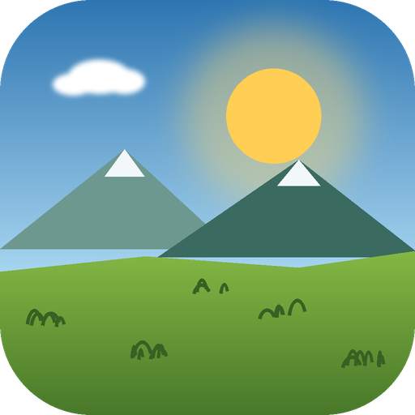
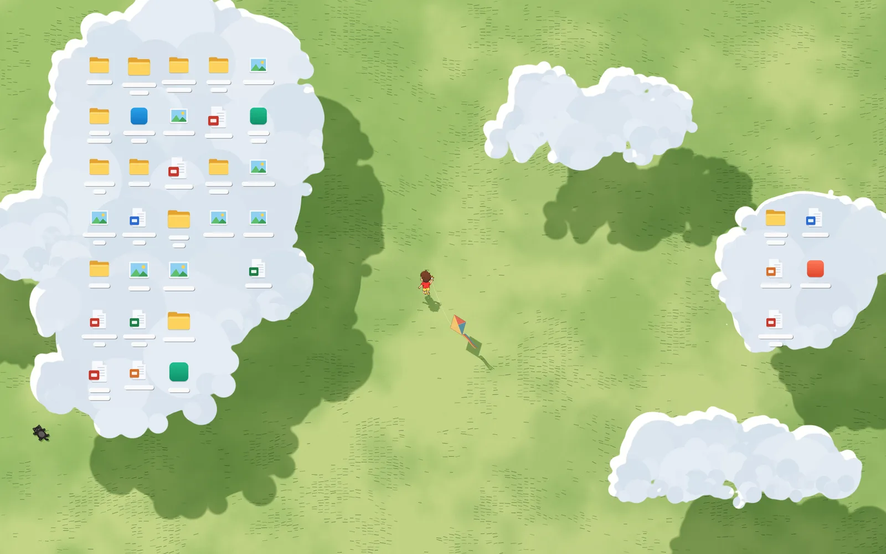
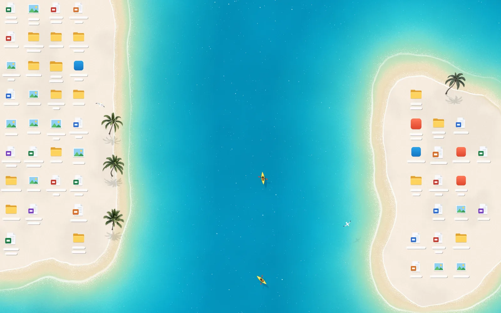
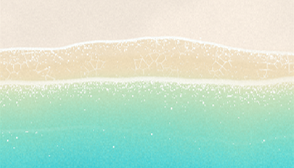
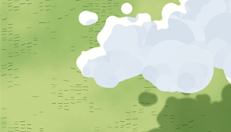
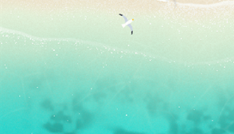
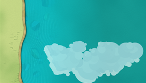
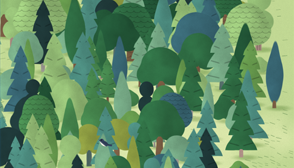
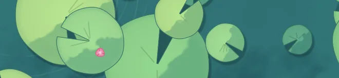

# Wallpaper



**Adaptive Windows wallpaper that makes your desktop icons part of the scenery.**

Wallpaper turns the space around your icons into a living landscape. Move, add or remove an icon and the beach, meadow, clouds and shadows quietly reshape around it — in real time, without AI, an account or an API key.

This is the **free, open-source Preview**, not a time-limited trial. It includes **all thirteen themes**, the Windows host, settings and sharing tools.

**English** · [简体中文](#中文说明) · [GitHub](https://github.com/xiaowulai-s/Wallpaper) · [Features](#features) · [Build from source](#build-from-source)





## Included themes

All thirteen themes are complete and freely usable — every parameter is adjustable and saved between sessions:

| Theme | Description |
| --- | --- |
|  **Beach** | Turquoise waves, kayaks, seabirds and coconut palms. |
|  **Meadow** | Drifting clouds and shadows, a boy flying a kite and a little black cat. |
|  **Maldives** | Turquoise water and pale beige sand, with schools of little fish swimming between dark coral reefs. |
|  **Lake** | Watercolor grass surrounds a clear lake, with painted stones beneath the shallows and crisp reflections of puffy clouds. |
|  **Sky** | A cartoon blue sky where your icons sit on puffy round clouds — day, dusk or night. |
|  **Ocean** | Looking down on a blue ocean — your icons hide in white clouds whose shadows fall on the sea. |
|  **Forest** | Your icons sit in a clearing ringed by gouache cartoon trees swaying in the breeze. |
|  **Pink Forest** | A watercolor forest: translucent pink treetops on fine ink trunks. |
|  **Hand-drawn City** | A bird's-eye map of an old town: rows of ink-drawn houses line the streets, and your icons sit in the squares. |
|  **Colorful City** | An illustrated city map with red roofs and yellow, pink and blue walls; your icons sit in the squares. |
|  **Old Map** | A parchment continent: icons become seas, dotted roads link towns, and horse-drawn wagons carry supplies between them. |
|  **Nautical Chart** | A parchment sea chart with coastal ports and lighthouses, winding sea routes, sailing ships and hand-drawn sea monsters. |
|  **Lotus Pond** | Lotus leaves and blossoms fill the pond, with koi swimming between the leaves and icons and leaving ripples. |

## Features

- **Adaptive scenery:** uses the real positions of desktop icons and transitions smoothly when they move.
- **Thirteen complete themes:** every setting of every theme is included and saved between sessions.
- **Made for the desktop:** tray controls, startup on sign-in and automatic pause when a window is maximized or full-screen.
- **Private sharing:** image and animation exports use sample icons and color blocks, never a screenshot of your desktop or real file names.
- **Independent installation:** Preview uses its own install directory, settings, startup entry and instance identity, so it can coexist with other Wallpaper builds.
- **English and Simplified Chinese:** no sign-in, purchase restoration, update service or store API is included.

## Requirements

- Windows 10 or Windows 11, 64-bit.
- Microsoft Edge WebView2 Runtime.
- PowerShell and the .NET Framework C# compiler included with Windows; no .NET SDK installation is required.
- An internet connection for the first build, which downloads the WebView2 development library.
- Node.js only if you want to run the browser preview.

Currently, Wallpaper renders on the **primary monitor** and targets 30 fps on integrated graphics.

## Build from source

Open PowerShell in the repository root:

```powershell
powershell -ExecutionPolicy Bypass -File host\build.ps1
host\bin\Wallpaper.exe
```

Keep `host/` and `prototype/` together. Build output is written to `host/bin/`.

Run the program again or double-click its tray icon to open Settings. To exit and restore the original Windows wallpaper, use the tray menu or run:

```powershell
host\bin\Wallpaper.exe --exit
```

Preview settings and logs are stored separately in `%LOCALAPPDATA%\WallpaperPreview`.

## Browser preview

```powershell
node prototype\serve.mjs
```

Open **http://localhost:5178/settings.html**. The browser uses sample icons; adaptation to real desktop icons requires the Windows host.

## Windows installer

Build the NSIS installer without installing global development tools:

```powershell
powershell -ExecutionPolicy Bypass -File tools\build-installer.ps1
```

The first build downloads portable NSIS and Microsoft's WebView2 bootstrapper. Artifacts are written to `dist/` with SHA256 checksums and a matching source ZIP.

The installer targets the current user's `Programs\Wallpaper` directory and does not require administrator rights. If WebView2 is missing, its bootstrapper requires an internet connection. Uninstalling preserves user settings.

[Download Wallpaper for Windows](https://github.com/xiaowulai-s/Wallpaper/releases/latest). The installer is unsigned, so Windows SmartScreen may show a warning.

## Project layout

| Path | Contents |
| --- | --- |
| `host/` | Windows host, build scripts and application manifest |
| `prototype/flat.html` | Beach theme |
| `prototype/meadow.html` | Meadow theme |
| `prototype/lib/` | Shared scene modules used by the new themes (terrain field, host link, scene kit, drawing kit) |
| `prototype/settings.html` | Settings interface |
| `prototype/themes.json` | Full definitions of all thirteen themes |
| `prototype/share.js` | Privacy-preserving image and animation sharing |
| `prototype/assets/` | Images used by the included themes |
| `tools/` | Installer build tooling |

## Known limitations

- Only the primary monitor is supported.
- Windows Spotlight or a wallpaper slideshow can briefly flash when Windows changes the background image.
- Preview does not include account sign-in, entitlement restoration, automatic updates or a store API.

## Credits and license

Source code and included theme assets are released under [GPL-3.0](LICENSE). Third-party dependencies are listed in [THIRD_PARTY_NOTICES.md](THIRD_PARTY_NOTICES.md).

The Wallpaper name and icon are not licensed as trademarks; modified distributions should use their own name and icon. See [TRADEMARKS.md](TRADEMARKS.md).

Issues and suggestions are welcome through GitHub Issues. This is an independent project, so immediate responses are not guaranteed.

---

## 中文说明

[English](#wallpaper) · **简体中文**

**让桌面图标成为风景的一部分。**

Wallpaper 是一款 Windows 自适应动态壁纸。移动、添加或删除桌面图标时，海岸线、草地、云朵和阴影会实时围绕图标调整。全部在本地实时演算，不使用 AI，无需账号或 API Key。

本仓库是**免费的开源体验版，不是限时试用版**，包含全部 13 个主题、Windows 宿主、设置界面与分享工具。

[GitHub 仓库](https://github.com/xiaowulai-s/Wallpaper) · [从源码运行](#build-from-source) · [许可](#credits-and-license)

### 包含的主题

全部 13 个主题都是完整主题，参数均可调整并自动保存：

| 主题 | 简介 |
| --- | --- |
|  **沙滩** | 海浪、皮划艇、海鸟和椰子树。 |
|  **草地** | 漂浮的云与云影、放风筝的男孩和小黑猫。 |
|  **马尔代夫** | 青绿色海水与浅米黄沙滩，暗色珊瑚礁间的小鱼成群游动。 |
|  **湖泊** | 水彩草地环绕清澈湖水，近岸浅水中显露青绿石块，湖面清晰映出圆鼓鼓的云朵。 |
|  **天空** | 卡通风的蓝天白云，图标坐在一团团圆鼓鼓的云上；可选白天、傍晚、晚上。 |
|  **大海** | 俯看蓝色的大海，图标藏在一朵朵白云里，云影落在海面上。 |
|  **森林** | 图标在林间的空地上，四周长满水粉风的卡通树，风吹得树梢轻轻摇。 |
|  **粉色森林** | 水彩画的森林：一团团透明的粉色树冠，细细的墨线树干。 |
|  **手绘城市** | 老城的鸟瞰地图：一排排墨线画的房子沿街排开，图标在广场上。 |
|  **彩色城市** | 彩色的城市插画地图：红屋顶、黄粉蓝的墙，图标在广场上。 |
|  **老地图** | 羊皮纸上的大陆：图标化为海域，城镇以虚线陆路相连，马车往返运送物资。 |
|  **航海地图** | 羊皮纸上的航海图：图标聚成陆地，沿岸有港口小镇和灯塔，弯曲航道穿过点缀着帆船与海怪的海洋。 |
|  **荷塘** | 荷叶荷花长满池塘，一群锦鲤在荷叶和图标之间游，荡开一圈圈涟漪。 |

### 功能

- **图标自适应：**读取真实桌面图标的位置，在移动、添加或删除时平滑调整场景。
- **13 个完整主题：**每个主题的全部参数均可调整并自动保存。
- **适合常驻桌面：**托盘控制、开机自动启动，前台窗口最大化或全屏时自动暂停。
- **隐私分享：**图片和动画使用示例图标与名字色块，不截取桌面窗口或真实文件名。
- **独立安装：**安装目录、用户数据、启动项和运行实例标识均独立，可与其他 Wallpaper 版本共存。
- **简体中文和英文：**不包含登录、购买恢复、自动更新或商店接口。

### 系统要求

- Windows 10 / Windows 11，64 位。
- Microsoft Edge WebView2 Runtime。
- 使用 Windows 自带的 .NET Framework C# 编译器，无需安装 .NET SDK。
- 第一次构建需要联网下载 WebView2 开发库。
- 仅浏览器预览需要 Node.js。

目前只覆盖**主显示器**，以核显 30fps 为目标。

### 从源码运行

在仓库根目录打开 PowerShell：

```powershell
powershell -ExecutionPolicy Bypass -File host\build.ps1
host\bin\Wallpaper.exe
```

请保持 `host/` 和 `prototype/` 的相对目录结构，编译结果位于 `host/bin/`。

再次运行程序或双击托盘图标可打开设置。退出并恢复系统原壁纸，请使用托盘菜单或执行：

```powershell
host\bin\Wallpaper.exe --exit
```

体验版的设置与日志独立保存在 `%LOCALAPPDATA%\WallpaperPreview`。

### 浏览器预览

```powershell
node prototype\serve.mjs
```

打开 **http://localhost:5178/settings.html**。浏览器使用示例图标，真实桌面图标适配需要 Windows 宿主。

### Windows 安装包

```powershell
powershell -ExecutionPolicy Bypass -File tools\build-installer.ps1
```

首次构建会下载便携版 NSIS 和微软 WebView2 引导程序，无需安装全局开发工具。产物位于 `dist/`，附 SHA256 校验文件和对应源码 ZIP。

安装包安装到当前用户的 `Programs\Wallpaper` 目录，无需管理员权限。缺少 WebView2 时需要联网安装；卸载保留用户设置。

[下载 Wallpaper Windows 安装包](https://github.com/xiaowulai-s/Wallpaper/releases/latest)。安装包未签名，Windows SmartScreen 可能显示提示。

### 目录结构

| 路径 | 用途 |
| --- | --- |
| `host/` | Windows 宿主、构建脚本与清单 |
| `prototype/flat.html` | 沙滩主题 |
| `prototype/meadow.html` | 草地主题 |
| `prototype/lib/` | 新主题共用的场景模块（地形场、宿主对接、场景骨架、绘制原语） |
| `prototype/settings.html` | 设置界面 |
| `prototype/themes.json` | 全部 13 个主题的完整定义 |
| `prototype/share.js` | 隐私保护的图片和动画分享 |
| `prototype/assets/` | 随附主题图片素材 |
| `tools/` | 安装包构建工具 |

### 已知限制

- 目前只支持主显示器。
- 使用 Windows 聚焦或壁纸幻灯片时，系统换图可能造成短暂闪烁。
- 体验版不包含账号登录、购买恢复、自动更新或商店接口。

### 许可与反馈

项目源码和随附主题素材按 [GPL-3.0](LICENSE) 发布，第三方依赖见 [THIRD_PARTY_NOTICES.md](THIRD_PARTY_NOTICES.md)。

Wallpaper 名称与图标不作为商标授权授予；修改版应使用自己的名称和图标，详见 [TRADEMARKS.md](TRADEMARKS.md)。

欢迎通过 GitHub Issues 反馈问题和建议。个人项目，不保证即时回复。
